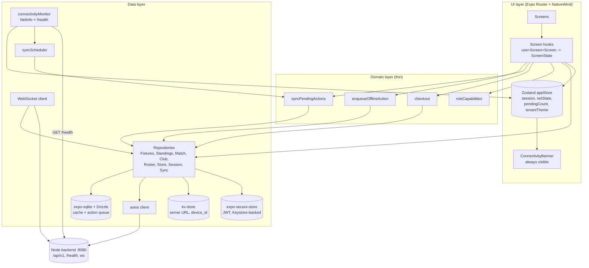
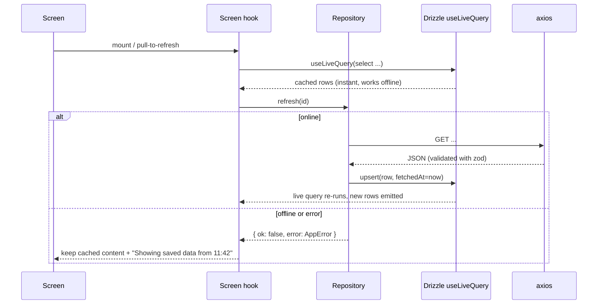

# Architecture Overview

Part of [the mobile architecture doc set](index.md). See [00-instructions-scope-and-assumptions.md](00-instructions-scope-and-assumptions.md) for scope and constraints that motivate these choices. Libraries are in [02-tech-stack-and-project-structure.md](02-tech-stack-and-project-structure.md).

## Pattern

**Screen + screen hook + offline-first repositories**, in three layers:

- **UI layer**: Expo Router screens (React components) styled with NativeWind. Each screen gets its data from one custom hook, `use<Screen>Screen()`, which returns a `ScreenState` object plus action functions. The hook plays the "ViewModel" role: screens contain no data-fetching logic.
- **Domain layer**: thin. Only modules with real logic: `enqueueOfflineAction`, `syncPendingActions`, `checkout`, `roleCapabilities`. Everything else calls repositories directly from screen hooks (no pass-through use cases).
- **Data layer**: repositories own the rule "SQLite is the single source of truth for cached data; network refreshes write into SQLite". Remote via axios; realtime via the built-in `WebSocket`; sync via `syncScheduler` (foreground triggers, no background task).

Why this and not more: the grading weight on the app is offline behaviour and HCI. Making SQLite the source of truth gives offline caching almost for free: screens read with Drizzle's `useLiveQuery`, so airplane mode just stops refreshes and the screen keeps showing rows. Redux, a DI framework or per-feature packages would cost build time without adding graded value.

## Layer diagram

See [03-components-and-responsibilities.md](03-components-and-responsibilities.md) for what each box in this diagram does.

## Read path (offline-first)

This read path applies to every cached repository (Fixtures, Standings, Match, Club, Roster, Store). See [06-data-persistence.md](06-data-persistence.md) for the schema it writes into and [05-state-management.md](05-state-management.md) for how the hook turns this into `ScreenState`.
