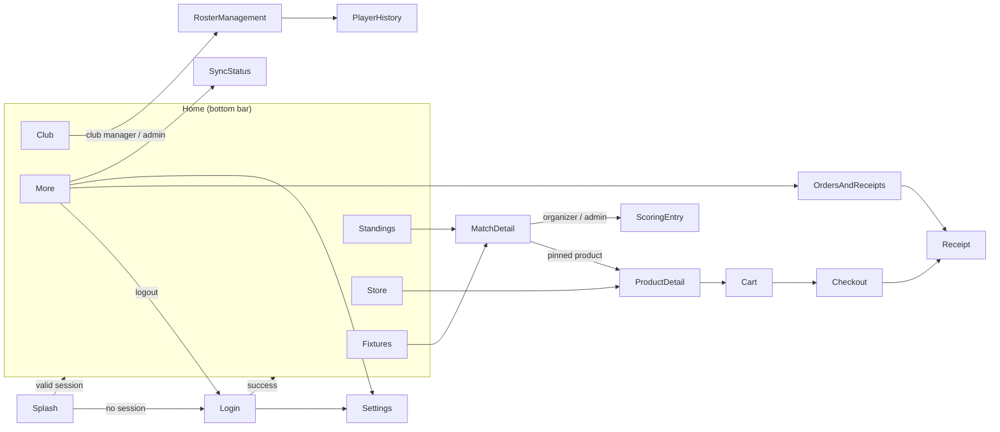

# Navigation

Part of [the mobile architecture doc set](index.md).

## Graph

## Route table

Routes use **Expo Router**: each file under `mobile/app/` is one route. `[param]` in a file name is a path parameter; `?param` below is an optional search (query) parameter.

| Route | File (`mobile/app/…`) | Params | Visible to | Notes |
| --- | --- | --- | --- | --- |
| `Splash` | `index.tsx` | | all | Reads session, redirects to Login or Fixtures |
| `Login` | `login.tsx` | | signed out | Email + password + "Server: 10.0.2.2:8080 (change)" link |
| `Fixtures` | `(tabs)/fixtures.tsx` | `?leagueId` | all roles | League selector at top (dropdown), status chips |
| `MatchDetail` | `match/[matchId]/index.tsx` | `matchId` | all roles | Live score, timeline, pinned products |
| `ScoringEntry` | `match/[matchId]/scoring.tsx` | `matchId` | organizer (own league), super admin | Start/End match, score buttons, compensation |
| `Standings` | `(tabs)/standings.tsx` | `?leagueId` | all roles | Same league selector as Fixtures (shared state in `appStore`) |
| `Club` | `(tabs)/club.tsx` | `?clubId` | all roles | Default: own club (manager/player), else club list of tenant |
| `RosterManagement` | `roster/[clubId].tsx` | `clubId`, `?leagueId` | club manager (own club), super admin | Transfer / loan / release |
| `PlayerHistory` | `player/[playerId].tsx` | `playerId` | manager, admin, the player self | Audit trail |
| `Store` | `(tabs)/store.tsx` | | all roles | Catalogue |
| `ProductDetail` | `product/[productId].tsx` | `productId` | all roles | Variant picker |
| `Cart` | `cart.tsx` | | all roles | Discount code field |
| `Checkout` | `checkout.tsx` | | all roles | Mock card options, see [09-key-flows.md](09-key-flows.md) §Checkout |
| `Receipt` | `receipt/[orderId].tsx` | `orderId` | all roles | In-app PDF view + Download + Share |
| `OrdersAndReceipts` | `orders.tsx` | | all roles | Local list of paid orders |
| `SyncStatus` | `sync.tsx` | | all roles | Pending queue + last results + Sync now |
| `More` | `(tabs)/more.tsx` | | all roles | Links to Sync status, Orders, Settings, Logout |
| `Settings` | `settings.tsx` | | all, also from Login | Server address, logout, app version |

Bottom bar (`(tabs)/_layout.tsx`, Expo Router `Tabs`) has 5 items with icon + text label: Fixtures, Standings, Store, Club, More. Max 2 taps from home to any judge task start.

Navigation rules:
- After login use `router.replace("/(tabs)/fixtures")` (not `push`) so Back never returns to Login.
- On logout or 401 use `router.replace("/login")`.
- Hardware Back pops the stack by default; never override it except to close an open dialog/bottom sheet.

## Role visibility matrix (UI only; server is the authority)

| UI element | Super admin | Organizer | Club manager | Player | Viewer |
| --- | --- | --- | --- | --- | --- |
| Fixtures, Standings, Match detail, Club (tenant clubs), Store | yes | yes | yes | yes | yes |
| "Enter score" button on Match detail | yes | own league only | no | no | no |
| "Manage roster" button on Club | yes | no | own club only | no | no |
| Player history | yes | no | own club players | self only | no |
| Clubs of other tenants | yes | no | no | no | no |

Hidden, not disabled, when a role can never use it (HCI area 5 — see [12-ui-and-hci.md](12-ui-and-hci.md)). If the server still returns 403, show the `FORBIDDEN` message (see [10-error-handling.md](10-error-handling.md)).

This matrix is implemented by `roleCapabilities` (see [03-components-and-responsibilities.md](03-components-and-responsibilities.md)) and is cosmetic only — real enforcement is server-side RBAC (see [11-security.md](11-security.md)).
