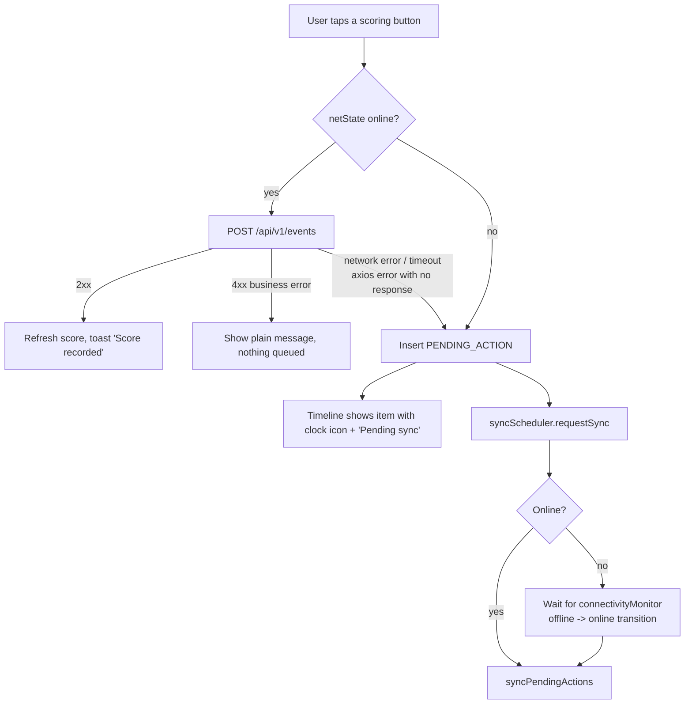
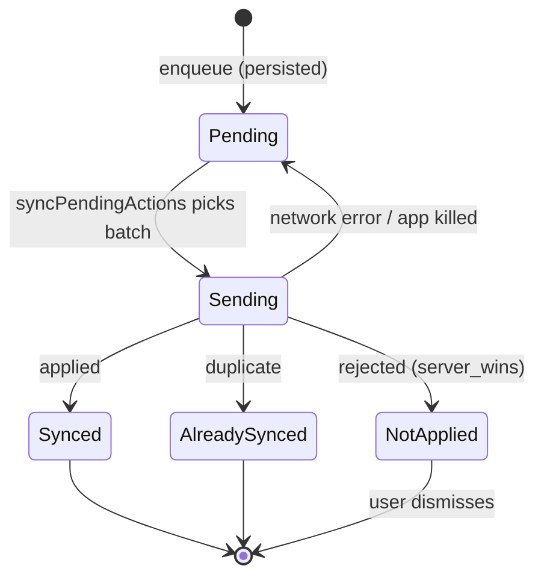

# Offline Tolerance and Sync (NFR-4)

Part of [the mobile architecture doc set](index.md). This is one of the two mobile-graded areas (offline, 4 pts — see [00-instructions-scope-and-assumptions.md](00-instructions-scope-and-assumptions.md)). The queued JSON format below must match `Docs/spec/` §5.14 byte for byte in field names — this is a non-negotiable (see root `CLAUDE.md`).

## What is queued

| User action | Queued type | Inner payload |
| --- | --- | --- |
| Score event (organizer) | `score_event` | spec §5.9 body `{event_id, match_id, type:"score", payload:{team_id, event_type}}` |
| Compensating event (organizer) | `score_event` | `{event_id, match_id, type:"compensation", payload:{compensates, reason}}` |
| Transfer / loan / release (manager) | `roster_transfer` | spec §5.11 body |

Match start/end, checkout, login are online-only (buttons disabled offline with reason text — checkout detail in [09-key-flows.md](09-key-flows.md)).

Note: spec §5.14 lists `score_event` with payload = "the /events request body", so compensation (also an /events body) goes through the same type.

## Exact queued action format (spec §5.14)

```json
{
  "action_id": "act-3f0c2d1e-...",
  "type": "score_event",
  "queued_at": "2026-10-17T11:00:00Z",
  "base_version": 3,
  "payload": {
    "event_id": "evt-9b1e...",
    "match_id": "m1",
    "type": "score",
    "payload": { "team_id": "t1", "event_type": "goal" }
  }
}
```

```json
{
  "action_id": "act-77aa...",
  "type": "roster_transfer",
  "queued_at": "2026-10-17T11:01:00Z",
  "base_version": 1,
  "payload": {
    "request_id": "tr-1c2d...", "league_id": "lg-r1", "player_id": "p2",
    "type": "loan", "from_squad_id": "sq-a", "to_squad_id": "sq-b",
    "effective_date": "2026-09-15", "loan_end_date": "2026-12-31",
    "reason": "Needs match time", "requested_by": "<session user_id>"
  }
}
```

Rules:
- `event_id`, `request_id`, `action_id` are generated once at enqueue and never regenerated. This makes retries idempotent (server returns `duplicate` / 200 replay).
- `base_version`: score = cached `SCORE_CACHE.version` for that match; roster = cached `ROSTER_PLAYER.audit_count`. Unknown → `0` (assumption A8 in [00-instructions-scope-and-assumptions.md](00-instructions-scope-and-assumptions.md)).
- `queued_at`: UTC, second precision, no milliseconds.
- Envelope: `{"device_id": "<settingsStore.deviceId>", "actions": [...]}`, actions in `local_id` order (server breaks `queued_at` ties by array order), max 100 per request; loop if more.
- Build each action with a zod schema whose keys are exactly the ones above, and send `payload_json` parsed back into an object (never a JSON string inside JSON).

`PENDING_ACTION` / `SYNC_RESULT` table columns are defined in [06-data-persistence.md](06-data-persistence.md).

## Online vs offline path



How to tell "network failure" from "server said no" in axios: a network failure or timeout rejects with `error.response === undefined`; a server answer always has `error.response.status`.

On a network failure the direct request is re-queued with the same `event_id`, so if it had actually reached the server the sync returns `duplicate`. No double events.

## Sync sequence

```mermaid
sequenceDiagram
  participant WM as syncScheduler
  participant UC as syncPendingActions
  participant DAO as SQLite (Drizzle)
  participant API as POST /api/v1/offline-sync
  participant Repo as match/roster repos
  WM->>UC: run()
  UC->>DAO: select PENDING order by local_id limit 100; mark SENDING
  UC->>API: {device_id, actions}
  alt HTTP 200
    API-->>UC: results[]
    loop each result
      UC->>DAO: insert SYNC_RESULT, delete PENDING_ACTION
    end
    UC->>Repo: refresh each affected match_id / player_id
    UC-->>WM: "success" (loop again if more PENDING rows remain)
  else network error / 5xx / 429
    UC->>DAO: revert SENDING -> PENDING, attempts++
    UC-->>WM: "retry" (exponential backoff 2, 4, 8 … max 60 s, only while online)
  else HTTP 400 (bad envelope)
    UC->>DAO: revert to PENDING, set last_error
    UC-->>WM: "failed" + show "Sync failed, please contact support"
  end
```

## Sync triggers

There is no background task (assumption A14 in [00-instructions-scope-and-assumptions.md](00-instructions-scope-and-assumptions.md)). The spec's desk check (§8.4 step 5) runs with the app open, and React Native background tasks are unreliable on Android and slow to set up.

`syncScheduler.requestSync()` is **single-flight**: if a sync is already running it does nothing, so concurrent triggers can never send the same rows twice. It is called:
- after each enqueue;
- when `connectivityMonitor` sees `offline` → `online`;
- on app start if the queue is non-empty;
- when `AppState` returns to `active` and the queue is non-empty;
- on the "Sync now" button (Sync status screen).

On app start, before the first sync, reset any `SENDING` rows left by a killed process back to `PENDING`. This is safe because ids are idempotent.

## Result mapping (spec §5.14) to UI

| status | resolution | UI label (icon + text) | Detail text |
| --- | --- | --- | --- |
| applied | appended | check + "Synced" | |
| applied | rebased_append | check + "Synced" | "Saved. Others had made changes first; yours was added after them." |
| duplicate | skipped_duplicate | check + "Already synced" | "This was already on the server. Nothing changed." |
| rejected | server_wins | warning + "Not applied" | `messageForCode(error_code)` — see [10-error-handling.md](10-error-handling.md) |

## Action state machine



## Desk check walk-through (spec §8.4) and how the design satisfies it

| Step | Judge does | App behaviour |
| --- | --- | --- |
| 1 | Opens Fixtures, Standings, Club profile online | Each refresh writes to SQLite |
| 2 | Airplane mode | NetInfo reports no connection (or the health ping fails), banner turns "Offline" (icon + text); screens render from SQLite with "Saved data from HH:MM" |
| 3 | Scores (organizer), roster action (manager) | Saved to `pending_actions`; toast "Saved offline. Will sync when you're back online."; shown as Pending in timeline / roster and in Sync screen; banner shows "Offline · 2 pending" |
| 4 | Force-close, reopen offline | SQLite file persists; queue and pending badges still shown. Session persists (token in expo-secure-store), no re-login needed |
| 5 | Network on | NetInfo + health ping → online → `syncScheduler` runs automatically; banner "Syncing 2..."; Sync screen lists per-action result with reason; queue empties |

Login offline: if a valid session exists, the app opens directly to cached Home. Switching roles offline (organizer → manager) is not possible since login needs the server; judges should do the roster step logged in as manager, or the team performs both roles on two devices/emulators. Document this in README demo steps (see [14-build-and-delivery.md](14-build-and-delivery.md)).
