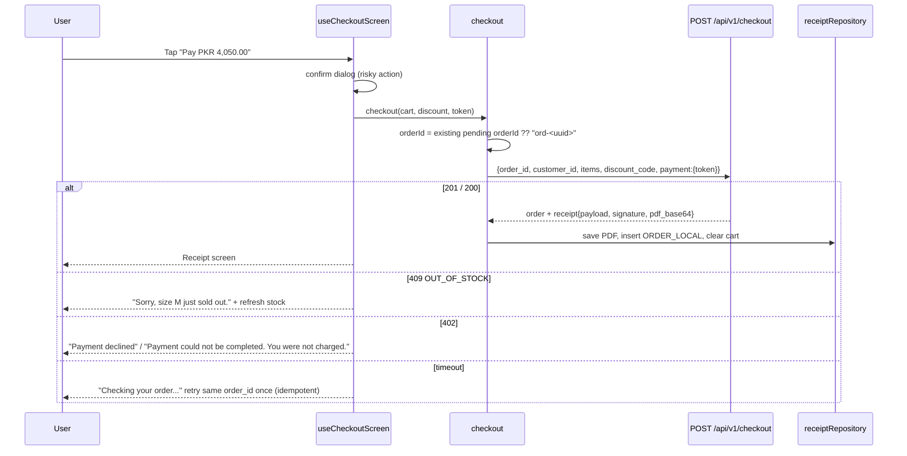

# Key Flows

Part of [the mobile architecture doc set](index.md).

## Checkout (NFR-3 safe from the client side)

- Mock payment picker (radio list with plain labels): "Test card: success" → `tok_success`, "Test card: declined" → `tok_declined`, "Test card: capture fails" → `tok_capture_fail`. Default success.
- Discount code: free text, uppercase; server validates. `400 INVALID_DISCOUNT_CODE` shown under the field.
- Buy button disabled while request in flight (prevents double taps) and when offline (checkout is online-only — see [08-offline-sync-and-tolerance.md](08-offline-sync-and-tolerance.md)).
- Prices shown from server; client never computes the final total for payment, only a preview `subtotal - floor(subtotal*10/100)` if `WELCOME10` entered, replaced by server numbers on response.

Endpoint shape: `POST /api/v1/checkout`, see [07-networking-and-api.md](07-networking-and-api.md) §Endpoint table.

## Receipt

- Save: write `pdf_base64` (base64 encoding) with `expo-file-system` to `<document directory>/receipts/{order_id}.pdf`; record the path in `ORDER_LOCAL.pdf_path`.
- View in-app with `react-native-pdf` (`<Pdf source={{ uri: fileUri }} />`, scrollable pages, pinch zoom built in).
  - **Fallback** if `react-native-pdf` fails to build: a "View PDF" button that opens the saved file in the phone's PDF viewer (`expo-file-system` `getContentUriAsync` + `expo-intent-launcher` `ACTION_VIEW`, type `application/pdf`). The receipt header below still shows in-app.
- "Download": `expo-file-system`'s Storage Access Framework folder picker. The user picks a folder (e.g. Downloads) and the PDF is copied there; toast "Saved to Downloads". No storage permission needed.
- "Share": `expo-sharing` `shareAsync(fileUri, { mimeType: "application/pdf" })`.
- Header shows order id, total, paid time in large text above the PDF.

## Scoring entry (config driven, no sport names)

- Load sport config via `sportRepository`. Buttons are generated from `scoring_events` keys for each team: label = key humanized (`raid_point` → "Raid point") + value ("+1", "6 runs", "1 round").
- Controls by `match status`: upcoming → "Start match"; in_progress → event buttons, discipline (optional), "End match"; completed → only corrections.
- Score header rendering by `scoring_model` only:
  - `event`: "2 – 1"
  - `innings`: "145/6 (18.3 ov)" from `score`, `wickets`, `overs`
  - `round`: "Rounds 1 – 2"
- Correction: each active `score` / `discipline` / `tiebreak_winner` timeline item has a "Correct" action → dialog with required reason → queues/sends `compensation`. Compensated items show strike-through + "Corrected" text label (not color only).
- Start/End use confirm dialogs. `TIE_NOT_ALLOWED` shows "Scores are level and this sport needs a winner. Record the tie-break winner first."

This flow must never branch on sport/event name — see the non-negotiable in [index.md](index.md) and [00-instructions-scope-and-assumptions.md](00-instructions-scope-and-assumptions.md). Offline queueing for scoring events is in [08-offline-sync-and-tolerance.md](08-offline-sync-and-tolerance.md).

## Roster action (club manager)

- Club → "Manage roster" → player row → bottom sheet (`BottomSheet` component, built on React Native `Modal`): Transfer / Loan / Release. ("Add" is not built; see assumption A13 in [00-instructions-scope-and-assumptions.md](00-instructions-scope-and-assumptions.md).)
- Form fields: destination squad (picker from `/leagues/{id}/squads`, own tenant only), effective date (`@react-native-community/datetimepicker`, default today), loan end date (loan only, must be after effective date, validated client-side), reason (required).
- Confirm dialog states consequence in words: "Release Bilal from Alpha FC? He will leave the league."
- Response `state: "deferred_until_match_end"` shown as "Accepted. Takes effect after match m-live ends."

Offline queueing for roster actions is in [08-offline-sync-and-tolerance.md](08-offline-sync-and-tolerance.md). Endpoint shape: `POST /api/v1/roster/transfer`, see [07-networking-and-api.md](07-networking-and-api.md).
